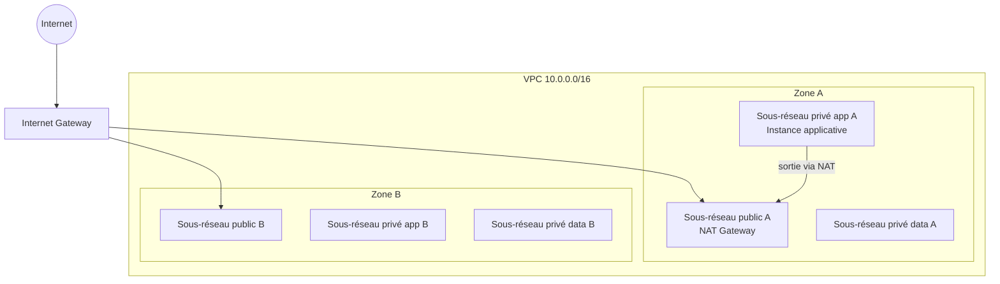

# Dossier d'architecture (livrable L2)

## 1. Schéma de l'architecture cible (niveau réseau, L3)

À compléter : ALB, base de données, S3, etc. au fil des livrables.

## 2. Justification des services (au regard de la liste du §4 du sujet)
| Service | Rôle dans le projet | Pourquoi ce choix | Alternative écartée |
|---|---|---|---|
| VPC + sous-réseaux multi-AZ | Isolation réseau, tolérance à la panne d'une zone | | |
| NAT Gateway | Accès sortant des sous-réseaux privés | voir ADR 0001 | |
| EC2 | Hébergement de l'API | | |
| (à compléter avec la liste du §4) | | | |

## 3. Décisions d'architecture
- [ADR 0001 : accès sortant](adr/0001-acces-sortant.md)
- [ADR 0002 : stratégie d'état Terraform](adr/0002-strategie-etat.md)

## 4. Estimation de coût
Capture ou export du **calculateur AWS** (https://calculator.aws) à joindre ici, avec les hypothèses (région, heures par mois, trafic). Les coûts réels dépendent du cycle de destruction hebdomadaire.

| Poste | Hypothèse | Coût mensuel estimé |
|---|---|---|
| NAT Gateway | | |
| EC2 | | |
| Total | | |

## 5. Alarme de budget
Configurée par Terraform (`infra/modules/budget`) : alertes e-mail à 50 %, 80 % et 100 % du budget, plus une prévision à 100 %. Joindre ici une capture de la console AWS Budgets.
